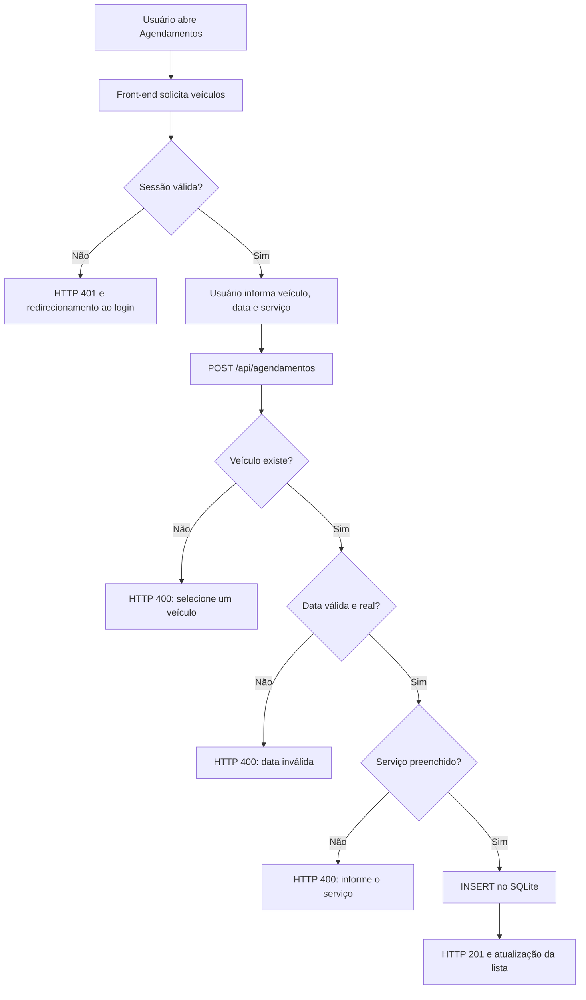

# Requisitos, regras e arquitetura — Oficina AutoCerta

## Escopo observado
Aplicação web de oficina mecânica para autenticação, cadastro/consulta/edição de clientes, cadastro/consulta de veículos e cadastro/consulta/alteração de data de agendamentos. O front-end é HTML/CSS/JavaScript sem framework; o back-end é Node.js com Express; o banco é SQLite (`node:sqlite`).

## Requisitos funcionais
- RF01 — O sistema deve permitir login com usuário e senha.
- RF02 — O sistema deve manter sessão autenticada e permitir consultar o usuário atual.
- RF03 — O sistema deve permitir encerrar a sessão.
- RF04 — O sistema deve listar clientes e pesquisar por nome, CPF, telefone ou e-mail.
- RF05 — O sistema deve cadastrar clientes com nome e CPF obrigatórios, CPF de 11 dígitos e e-mail validado quando informado.
- RF06 — O sistema deve permitir editar dados de clientes existentes.
- RF07 — O sistema deve impedir CPF duplicado entre clientes.
- RF08 — O sistema deve listar veículos com dados do cliente associado.
- RF09 — O sistema deve cadastrar veículos com placa, modelo, tipo e cliente existente.
- RF10 — O sistema deve aceitar placa antiga e Mercosul e impedir placas duplicadas.
- RF11 — O sistema deve listar agendamentos com dados de veículo e cliente.
- RF12 — O sistema deve cadastrar agendamento com veículo existente, data válida e serviço.
- RF13 — O sistema deve permitir alterar somente a data de um agendamento.
- RF14 — O sistema deve retornar erros HTTP e mensagens JSON para entradas inválidas e recursos inexistentes.
- RF15 — O sistema deve armazenar senha com hash bcrypt e CPF criptografado.

## Regras de negócio observadas
- RN01 — Login e senha são obrigatórios; login é comparado após `trim()`, senha é verificada com `bcrypt.compareSync`.
- RN02 — Rotas de dados exigem `req.session.usuario`; ausência resulta em HTTP 401.
- RN03 — CPF é normalizado para dígitos antes de validar e armazenar.
- RN04 — CPF deve conter 11 dígitos; não há validação matemática dos dígitos verificadores.
- RN05 — CPF deve ser único, verificado por descriptografia em memória.
- RN06 — Placa é normalizada para maiúsculas e remoção de espaços/hífens; regex `^[A-Z]{3}\d[A-Z0-9]\d{2}$`.
- RN07 — Modelo e tipo do veículo são obrigatórios; cliente precisa existir.
- RN08 — Agendamento exige veículo existente, data real no formato `AAAA-MM-DD` e serviço não vazio.
- RN09 — Editar agendamento altera apenas a data, não veículo nem serviço.
- RN10 — Não existe regra que impeça agendamentos passados, conflitos de horário ou duplicidade de agendamento.
- RN11 — O sistema não implementa autorização por perfil; qualquer usuário autenticado tem acesso às rotas disponíveis.
- RN12 — O banco SQLite usa chaves estrangeiras, mas a integridade depende de `PRAGMA foreign_keys = ON` na conexão.

## Modelo de dados / DER
Ver `der.png`. Entidades:
- **usuarios** (`id`, `nome`, `login`, `senha`): `login` é único; `senha` guarda hash bcrypt.
- **clientes** (`id`, `nome`, `cpf`, `telefone`, `email`): `cpf` guarda conteúdo cifrado.
- **veiculos** (`id`, `placa`, `modelo`, `tipo`, `marca`, `cliente_id`): placa única; FK para clientes.
- **agendamentos** (`id`, `veiculo_id`, `data_agendamento`, `servico`): FK para veículos.

Cardinalidades: cliente 1:N veículos; veículo 1:N agendamentos. Usuário não tem relação direta com as demais entidades.

## Mapa da API
Todas as respostas são JSON, salvo páginas estáticas. Rotas de dados marcadas como protegidas usam `exigirLogin`.

| Método e rota | Autenticação | Entrada | Sucesso | Validações/erros |
|---|---|---|---|---|
| `POST /api/login` | Não | `{login, senha}` | `200 {ok:true}` | `400` se faltar campo; `401` credenciais inválidas |
| `POST /api/logout` | Não exigida | Nenhuma | `200 {ok:true}` após destruir sessão | callback de destruição não trata erro |
| `GET /api/me` | Sim | Nenhuma | `{id,nome}` | `401` sem sessão |
| `GET /api/clientes?busca=` | Sim | Query `busca` opcional | Array de clientes com CPF descriptografado | Sem paginação; descriptografa todos para filtrar |
| `POST /api/clientes` | Sim | `nome, cpf, telefone?, email?` | `201 {ok:true}` | `400` nome/CPF/e-mail inválidos ou CPF repetido |
| `PUT /api/clientes/:id` | Sim | mesmos campos do cadastro | `200 {ok:true}` | `404` inexistente; `400` validação |
| `GET /api/veiculos` | Sim | Nenhuma | Array de veículos com `cliente_nome` | INNER JOIN omite veículo sem cliente válido |
| `POST /api/veiculos` | Sim | `placa, modelo, tipo, marca?, cliente_id` | `201 {ok:true}` | `400` placa inválida/duplicada, campos ausentes ou cliente inexistente |
| `GET /api/agendamentos` | Sim | Nenhuma | Array com dados do agendamento, veículo e cliente; CPF descriptografado | Sem paginação |
| `POST /api/agendamentos` | Sim | `veiculo_id, data_agendamento, servico` | `201 {ok:true}` | `400` veículo inválido, data inválida ou serviço vazio |
| `PUT /api/agendamentos/:id` | Sim | `data_agendamento` | `200 {ok:true}` | `404` agendamento inexistente; `400` data inválida |

## Mapa do front-end
| Página | Script(s) | Rotas chamadas | Função |
|---|---|---|---|
| `login.html` | `js/comum.js`, `js/login.js` | `POST /api/login` | Login e exibição de erro; redireciona para `principal.html` |
| `principal.html` | `js/comum.js` | `GET /api/me`, `POST /api/logout` | Painel de navegação e identificação do usuário |
| `clientes.html` | `js/comum.js`, `js/clientes.js` | `GET /api/me`, `POST /api/logout`, `GET /api/clientes`, `POST /api/clientes`, `PUT /api/clientes/:id` | Busca, listagem, cadastro e edição |
| `veiculos.html` | `js/comum.js`, `js/veiculos.js` | `GET /api/me`, `POST /api/logout`, `GET /api/veiculos`, `GET /api/clientes`, `POST /api/veiculos` | Lista e cadastra veículos |
| `agendamentos.html` | `js/comum.js`, `js/agendamentos.js` | `GET /api/me`, `POST /api/logout`, `GET /api/agendamentos`, `GET /api/veiculos`, `POST /api/agendamentos`, `PUT /api/agendamentos/:id` | Lista, cria e altera data de agendamentos |
| `css/style.css` | — | — | Estilos compartilhados |

`comum.js` centraliza `fetch`, redirecionamento em HTTP 401, escape HTML (`esc`), formatação e modais. A interface usa `textContent` para mensagens e escapa valores inseridos em HTML via template string.

## Análise de segurança
### Controles existentes
- **Sessão:** `express-session`, duração de cookie de 30 minutos (`maxAge`), `httpOnly: true`. Não há `secure`, `sameSite` explícitos, rotação do ID após login nem store persistente configurado; o padrão MemoryStore não é adequado à produção.
- **Hash de senha:** `bcryptjs` e `bcrypt.compareSync`; hashes seed indicam custo 08. O código não cria/atualiza usuários e não contém fluxo de troca de senha.
- **Criptografia do CPF:** AES-256-GCM, chave de 32 bytes derivada via `scryptSync`, IV aleatório de 12 bytes e tag de autenticação. Porém, chave e salt estão fixos no código; isso não equivale a gestão segura de segredos. O banco contém CPFs cifrados.
- **SQL injection:** consultas usam parâmetros `?` nos valores dinâmicos observados.
- **XSS:** front-end aplica `esc()` para os valores renderizados via `innerHTML`; avisos usam `textContent`.

### Riscos e limitações
1. Segredo da sessão e chave/salt de CPF hardcoded no repositório.
2. Cookie sem `secure`/`sameSite` explícitos e store de sessão padrão em memória.
3. Ausência de limitação de tentativas de login, CSRF explícito, controle de autorização por papel e validação matemática do CPF.
4. CPF é devolvido em texto claro pela API para usuários autenticados, inclusive na listagem de agendamentos.
5. Listagens sem paginação; busca de clientes descriptografa todos os CPFs em cada solicitação.
6. `express-session` não define `saveUninitialized` false? Define false, mas não tem store de produção.
7. Não há HTTPS configurado no código do servidor; deve ser terminado em proxy confiável em produção.

### Três melhorias prioritárias
- **M1 — Segredos e sessão:** ler `SESSION_SECRET` e chave de criptografia de variáveis de ambiente/secret manager; rotacionar o ID da sessão após login; configurar cookie `httpOnly`, `secure` em HTTPS e `sameSite: 'lax'`; usar store persistente.
- **M2 — Proteção de autenticação e autorização:** limitar tentativas por IP/usuário, adicionar proteção CSRF compatível com sessão e aplicar autorização por perfil/ação; manter mensagens de erro genéricas.
- **M3 — Minimização de dados e validação:** não retornar CPF completo por padrão (mascarar ou exigir permissão), validar dígitos verificadores, adicionar paginação e impor restrições únicas/índices apropriados no banco.

## Fluxo — cadastrar agendamento

## Código comentado
A pasta `sistema_comentado/` contém cópia da aplicação. Comentários foram adicionados a pontos de decisão do `server.js` e `seguranca.js` explicando intenção e motivo, sem alterar o comportamento. Os comentários não substituem os comentários linha a linha que podem ser necessários para a avaliação; concentre a revisão em validações, sessão, SQL parametrizado e criptografia.
